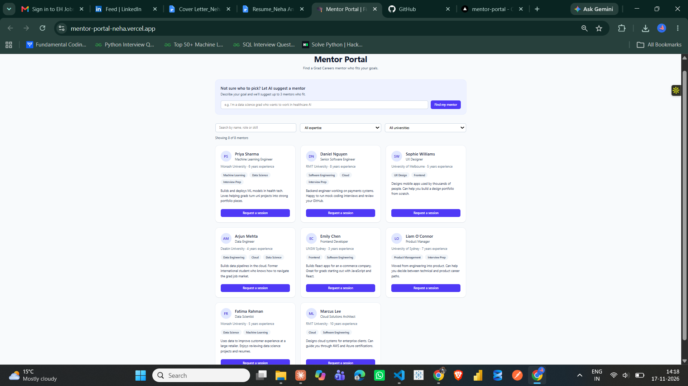
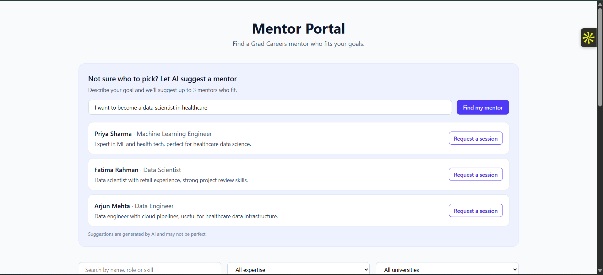

# Mentor Portal

**Live site:** https://mentor-portal-neha.vercel.app/

A React web app where students can find a Grad Careers mentor who fits their goals. Users can browse 8 mentors, search and filter them by expertise and university, request a session through a validated booking form, or describe their goal and get up to 3 AI-suggested mentors.

> The mentors are invented sample data, and the booking flow is a demo: no request is actually sent.



## Features

- **Browse mentors** as cards showing role, university, years of experience, expertise and a short bio
- **Search** by name, role or skill, updating as you type
- **Filter** by expertise and university, combined with search, with a "Showing X of 8 mentors" count
- **Empty state** with a "Clear filters" button when nothing matches
- **Booking form** in a popup, with validation for name, email, a future date and a message of at least 10 characters
- **AI mentor match**: describe your goal and an LLM (GPT OSS 20B via Groq) suggests up to 3 mentors, each with a reason and a "Request a session" button
- **API key kept on the server** through a Vercel serverless function, so it never reaches the browser
- **Accessible**: labelled inputs, a dialog role on the popup, and error messages announced to screen readers
- **Lighthouse scores of 100** for Performance, Accessibility, Best Practices and SEO

## Tech stack

React, Vite, JavaScript (JSX), Tailwind CSS v4, Vercel (hosting and serverless functions), Groq API (GPT OSS 20B), ESLint, Git and GitHub

## How the AI match works

```
Browser (MentorMatch.jsx)
  -> POST /api/match  {"goal": "I want to become a data scientist in healthcare"}
Vercel serverless function (api/match.js)
  -> checks the goal is 10 to 500 characters
  -> sends the goal and the mentor list (by ID) to GPT OSS 20B via Groq
     (JSON mode, temperature 0, low reasoning effort)
  -> keeps only real mentor IDs, removes duplicates, requires a reason,
     cuts reasons to 200 characters, returns at most 3
  -> {"matches": [{"id": 1, "reason": "..."}]}
Browser
  -> looks up each mentor by ID and shows the suggestions
```

If the goal is invalid the function returns `400`. If the API key is missing, Groq is unreachable or the model returns nothing usable, it returns `503`, and the page shows a friendly error instead of crashing.



## Key decisions

- **State lives in `App.jsx`, and components stay simple.** App holds the search text, filters and selected mentor, and passes them down as props. `SearchBar`, `FilterBar` and `MentorCard` only display data and report events back up ("data down, events up").
- **Filtered mentors are calculated, not stored.** `filteredMentors` is worked out from the search text and filters on every render, so it can never get out of sync.
- **The API key never reaches the browser.** The browser calls `/api/match` on the same site, and only the serverless function holds `GROQ_API_KEY`. Same origin also means no CORS setup is needed.
- **Never trust raw LLM output.** The model only sees mentor IDs, and anything that isn't a real ID is thrown away. This also limits what a prompt-injection attempt in the goal box can do.
- **The AI is clearly labelled.** Suggestions carry the note "Suggestions are generated by AI and may not be perfect."

## Project structure

```
mentor-portal/
├── api/
│   └── match.js             Vercel serverless function: validates the goal, calls Groq, cleans the matches
├── public/
│   └── robots.txt
├── src/
│   ├── components/
│   │   ├── BookingModal.jsx  booking popup with validation and confirmation
│   │   ├── FilterBar.jsx     expertise and university dropdowns
│   │   ├── MentorCard.jsx    one mentor card
│   │   ├── MentorMatch.jsx   AI goal box, loading and error states, suggestions
│   │   ├── SearchBar.jsx     search input
│   │   └── inputStyles.js    shared Tailwind classes for inputs
│   ├── data/
│   │   └── mentors.js        8 sample mentors
│   ├── App.jsx               state, filtering and page layout
│   ├── index.css             Tailwind import
│   └── main.jsx
├── eslint.config.js
├── index.html
├── package.json
└── vite.config.js
```

## Run it locally

You need Node.js and the Vercel CLI (`npm install -g vercel`).

```bash
git clone https://github.com/nehaanil79/mentor-portal.git
cd mentor-portal
npm install
```

Create a `.env` file in the project folder (get a free key at console.groq.com):

```
GROQ_API_KEY=gsk_your_key_here
```

Then run:

```bash
vercel dev
```

Open `http://localhost:3000`. Use `vercel dev` rather than `npm run dev`: `npm run dev` only runs the frontend, so the AI match won't work.

## Deployment

Deployed on Vercel and connected to this GitHub repo. Vercel builds the React app with `npm run build`, serves the `dist` folder, and turns `api/match.js` into a serverless function. `GROQ_API_KEY` is set in Vercel's Environment Variables, and every push to `main` redeploys the site.

## Limitations

- Mentors are hard-coded sample data, not loaded from a database.
- Bookings are not saved or sent anywhere.
- Everything is on one page, with no routing.
- The booking popup doesn't yet close with the Escape key or keep keyboard focus inside it.

## Future improvements

- Pagination for when there are more mentors
- Routing with React Router, for example a page per mentor and a separate page for AI suggestions
- Escape-to-close and a focus trap for the booking popup
- A real backend and database for mentors and bookings
